# The data flow, level by level: from the whole system down to pseudocode

Drawn by an outside model (GPT-5.6 Sol, "max" setting, through Cursor; blind: it saw a brief with the record's facts
and the behaviour of the code described in words, no repository file), checked here against the code on main
(`max/sws/line_beta/`, its C half in `c_half/`) and the record. Simulated and calculated, not measured. Nothing is
selected: alternatives stay side by side. The outside answer, unchanged: [sol_dataflow_answer.md](sol_dataflow_answer.md)
("input.md" in the drawings means the brief). Own arithmetic: [dataflow_check.py](dataflow_check.py) →
[dataflow_check.json](dataflow_check.json).

## The counts, everywhere below

| Unit | Halves | Sensing elements | Root boxes |
|---|---|---|---|
| One half | 1 | 16 (8 radial, 8 axial) | — |
| One SWS (one head) | 2 | 32 | — |
| One winch, large installation (two SWS) | 4 | 64 | 1 |
| Large installation (51 winches = 102 SWS) | 204 | 3 264 | 51 |
| First installation (6 SWS, one per winch) | 12 | 192 | 6 |

## In six sentences

1. Each half turns 16 channels of 4 000 converter results a second into 250 values a second per channel, packs 25 of
   them per channel into a 1 229-byte frame every 100 ms, and sends it over its own serial line (123.5 kbit/s on the wire).
2. The root box checks every frame, counts every loss, adds 9 bytes (receive time and a quality byte), and forwards
   it unchanged over MQTT; when the network is down it holds the frames on disk and sends them later, oldest first.
3. The logger stores every message as received and, from the data alone, puts frames in order, gives each sample a
   time from the 1 Hz edge latch, finds when the rope moves, cuts runs, and works out position from the strand ripple.
4. Per half that is 4 000 values and about 12.4 kB a second; the first installation (12 halves) sends 48 000 values
   and 149 kB a second, the large one (204 halves) 816 000 values and 2.5 MB a second (arithmetic on level 0).
5. The drawings match the code in all but three places, corrected in a copy or noted under the pseudocode: the
   1 Hz edge is latched when a frame completes (not at each line sample), a frame of the wrong type is counted as
   "wrong half", and the logger smooths with the mains-period mean rather than subtracting it.
6. The check found three things in the code and settings themselves: 125 values a second, listed as an alternative,
   does not fit a 100 ms frame (12.5 samples: the Python half rounds to 12, 96 ms frames; the settings helper the C
   half is fed from refuses it); the 4 096 MB buffer cap holds about 22.5 h, not 24 h, for a root box with four
   halves; and when the network drops again during a replay of more than 2 000 buffered records, the unsent part of
   the batch is put back behind the rest, so the order is not kept.

## Level 0 — the whole system

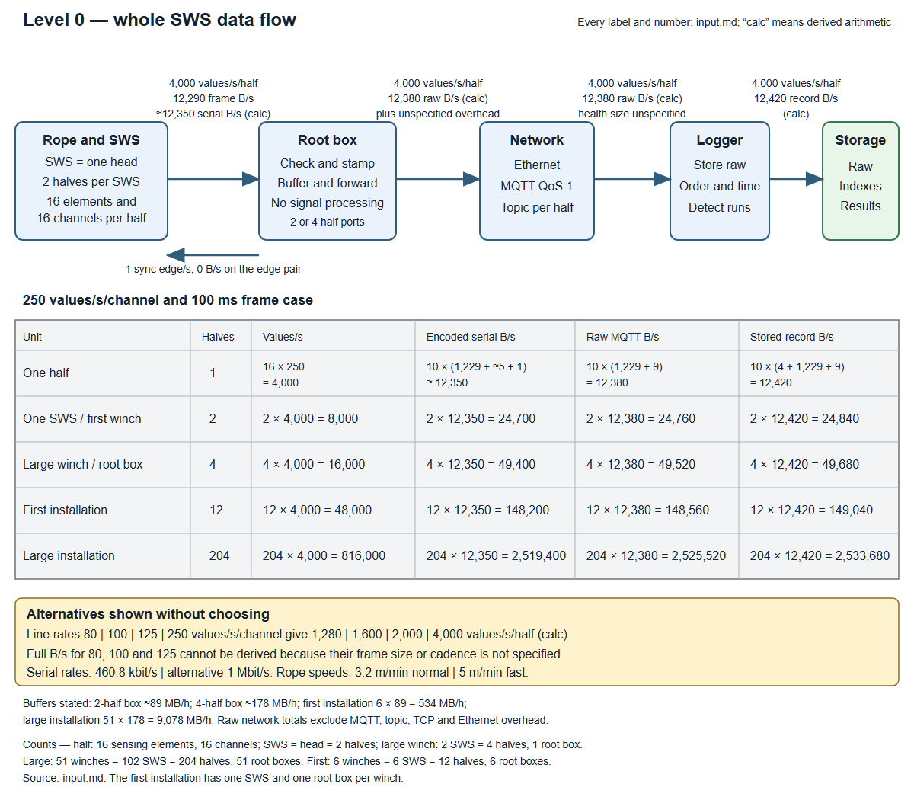 [svg](l0_system_readable.svg) · outside original: [png](l0_system.png), [svg](l0_system.svg)
Rope and SWS → root box → network → logger → storage, with values and bytes per second on every arrow.
The table scales one half (4 000 values/s, 12 380 B/s over MQTT) to an SWS, a winch and both installations.
Readable copy: only the arrow labels moved above the boxes; the numbers agree with own arithmetic.

## Level 1 — one winch

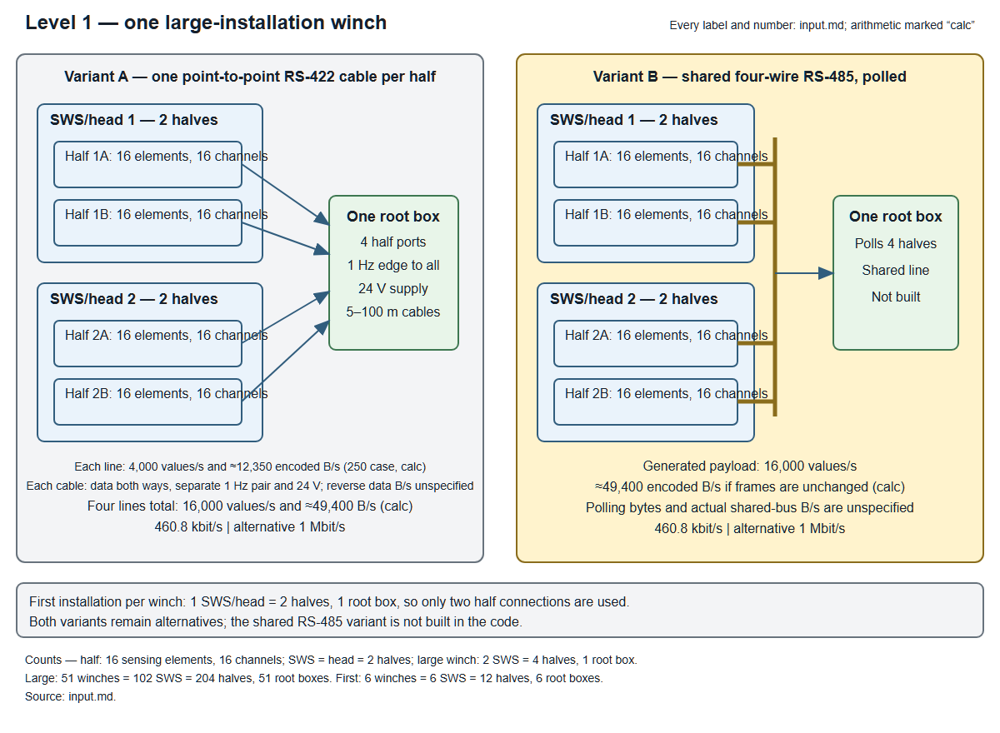 [svg](l1_winch.svg)
One winch on the large installation: two SWS, four halves, one root box; on the first installation two halves.
Left: one RS-422 line per half (the record, built in the code). Right: one shared four-wire RS-485 line (not built).
**Not as the record:** the record counts the shared line as two-wire, polled (data_path.md: four halves need 1 Mbit/s at 250 per second, 50 % load); "four-wire" is the request's wording; four-wire RS-485 parts on record are one half per line.

## Level 2 — inside the half, the root box and the logger

**2A — inside one half.** 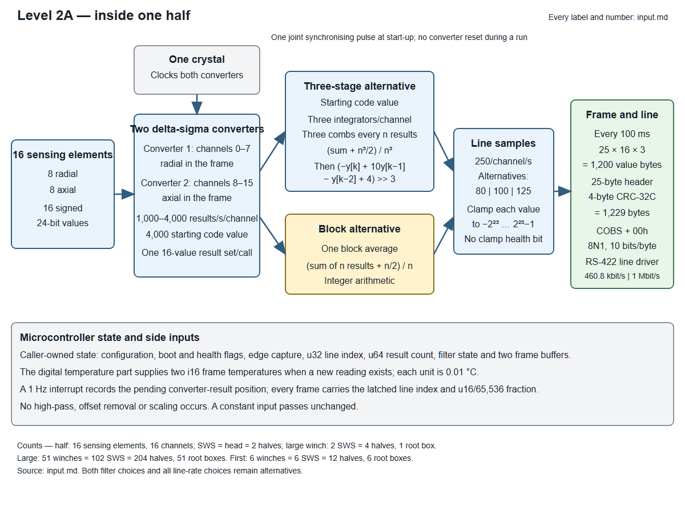 [svg](l2a_half_readable.svg) · outside original: [png](l2a_half.png), [svg](l2a_half.svg)
Sensing elements → two converters on one crystal → three-stage or block filter → clamp → frame → COBS → line.
The 1 Hz edge is latched as a line-sample index and fraction; no high-pass, offset removal or scaling.
**Readable copy:** the start-up pulse note moved above the boxes (hidden in the original). **Partly on record:** the link note §1 puts channels 0–7 on the first converter and the frame orders 0–7 radial, so the first converter carries the radial channels by inference; the record's two temperatures are carrier and yoke, the beta writes one value into both fields.

**2B — inside the root box.** 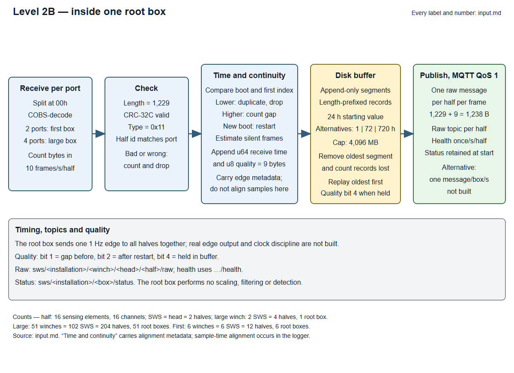 [svg](l2b_root_box.svg)
Receive per port → check (COBS, CRC-32C, type, half id) → continuity and stamp → disk buffer → publish.
The root box carries the edge latch but does not align samples; the code does that at the logger.
**Differs from the record:** the link note and the specification put alignment and processing in the root box; the code and the newer thought put them at the logger.

**2C — inside the logger.** 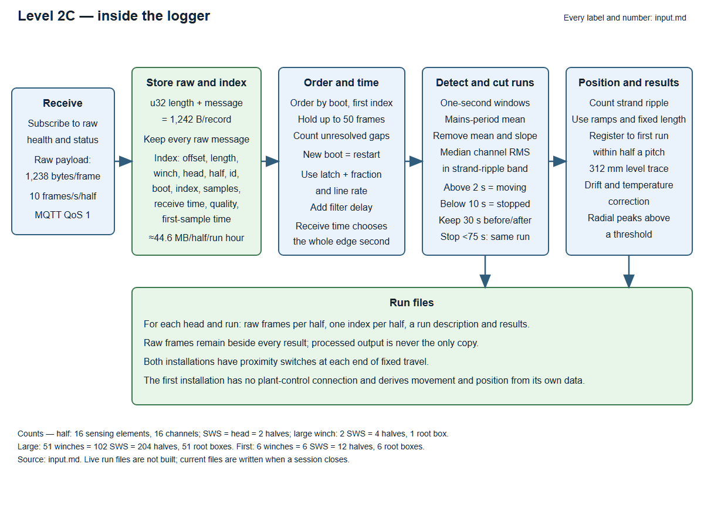 [svg](l2c_logger.svg)
Receive → store raw and index → order and time → detect movement and cut runs → position and results → run files.
Raw frames stay beside every result.
**Not drawn:** the code processes half 0 of each head only, and writes run files when the session closes (not live). The proximity switches and the missing control-system link are given facts, not in the files checked.

## Level 3 and level 4 — each box as a sequence, with its pseudocode

Pseudocode is the outside model's, unchanged; the corrections below each block are ours (the code on main).

### L3-H1 — the half: one converter result, one line sample, one edge

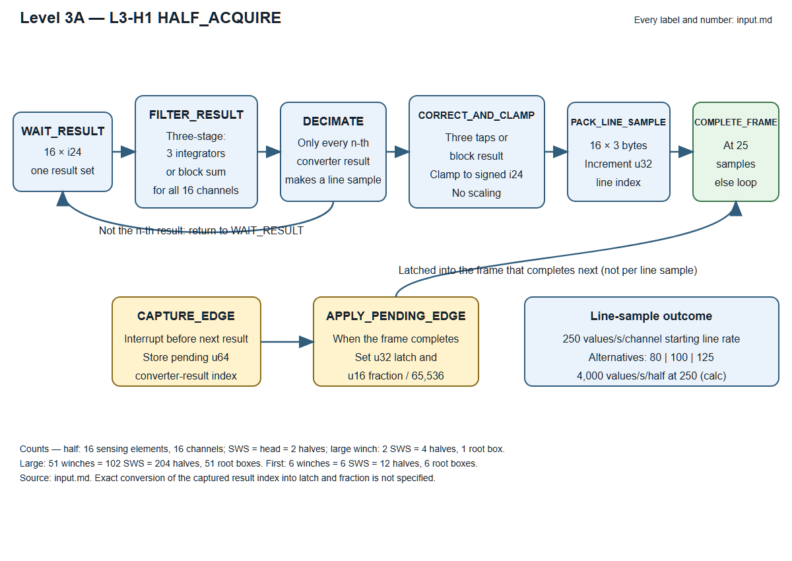 [svg](l3a_half_acquire_corrected.svg) · outside original: [png](l3a_half_acquire.png), [svg](l3a_half_acquire.svg)
Each converter result goes into the filter; every n-th result makes a line sample, corrected, clamped and packed.
An edge stores the converter-result index; it is turned into latch and fraction when the frame completes.
**Corrected copy:** the original latched the edge at the next line sample.

```text
type i24 = signed 3-byte integer; type i16 = signed 2-byte integer
type u16 = unsigned 2-byte integer; u32 = unsigned 4-byte integer
type u64 = unsigned 8-byte integer; SampleSet = i24[16]
state result_index:u64, line_index:u32, fill_count:u8, n:integer
state edge_pending:bool, pending_result:u64, latch:u32, fraction:u16
state cic_integrator:u64[16][3], cic_comb_delay:u64[16][3]
state block_sum:integer[16], correction_history:integer[16][2]

CAPTURE_EDGE:
    edge_pending = true; pending_result = result_index

FILTER_RESULT(x:SampleSet, optional temperatures:i16[2]):
    result_index += 1
    if filter_id == THREE_STAGE:
        for channel 0..15: update three wrapping u64 integrators with x[channel]
    else if filter_id == BLOCK:
        for channel 0..15: block_sum[channel] += x[channel]
    if result_index is not the configured n-th result: return no frame

DECIMATE:
    if filter_id == THREE_STAGE:
        for channel 0..15: y[channel] = THREE_COMBS(channel)
        for channel 0..15: y[channel] = (y[channel] + n^3/2) / n^3
    else:
        for channel 0..15: y[channel] = (block_sum[channel] + n/2) / n
        clear block_sum

APPLY_PENDING_EDGE:
    if edge_pending: (latch, fraction) = MAP_CAPTURE_TO_LINE_POSITION(pending_result)
    if edge_pending: edge_pending = false; edges_seen += 1

CORRECT_AND_CLAMP:
    if filter_id == THREE_STAGE:
        out = (-y[k] + 10*y[k-1] - y[k-2] + 4) >> 3 for every channel
    else: out = y
    clamp every out to [-2^23, 2^23 - 1]

PACK_LINE_SAMPLE:
    pack 16 out values as little-endian signed 24-bit; line_index += 1
    fill_count += 1; if fill_count == 25: invoke COMPLETE_FRAME
```

Against the code: `APPLY_PENDING_EDGE` runs in `half_push` when a frame completes, not per line sample: latch =
converter index of the edge / n, fraction = (index mod n) × 65 536 / n (`half_core.c`); if several edges arrive in
one frame, the last one is latched and edges seen goes up by their number. The block filter's sum is a signed 64-bit
running sum. Otherwise as the code.

### L3-H2 — the half: one frame, a full send buffer, a restart

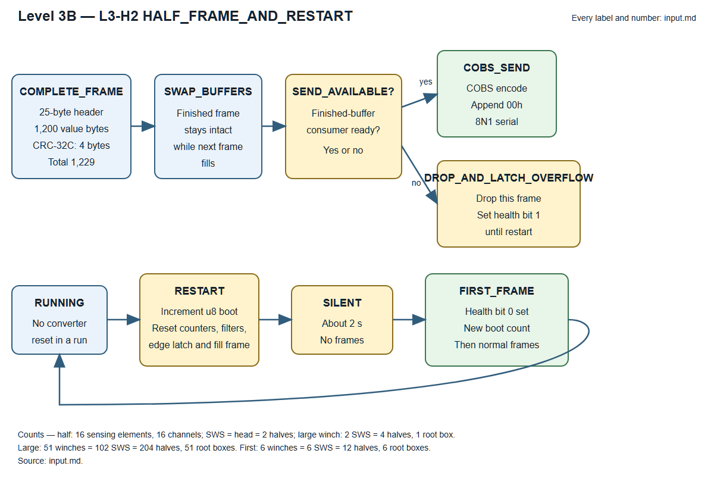 [svg](l3b_half_frame_restart.svg)
A completed frame gets its header and CRC-32C, the buffers swap, the frame is COBS-encoded and sent with a 00h.
A frame that does not fit the send buffer is dropped and health bit 1 stays set until a restart; a restart raises the boot count.
**Differs from the code:** the drop happens when the 8 192-byte send buffer is full (setting), not when the line is "busy".

```text
type byte = u8; Frame = byte[1229]; Header = byte[25]
state fill:Frame, finished:Frame, boot_count:u8, frame_count:integer
state first_after_boot:bool, send_overflow:bool, send_busy:bool

COMPLETE_FRAME:
    fill[0] = 0x11; fill[1] = half_id
    put_u32_le(fill[2..5], first_sample_index)
    fill[6] = 25
    fill[7] = (filter_id << 6) | (converter_rate_code << 3) | line_rate_code
    put_u16_le(fill[8..9], first_after_boot_bit | send_overflow_bit)
    fill[10] = boot_count; fill[11] = edges_seen
    put_u32_le(fill[12..15], latch); put_u16_le(fill[16..17], fraction)
    put_i16_le(fill[18..19], temperature_1)
    put_i16_le(fill[20..21], temperature_2)
    fill[22] = low_byte(frame_count); put_u16_le(fill[23..24], aux_value)
    keep packed samples in fill[25..1224]
    put_u32_le(fill[1225..1228], CRC32C(fill[0..1224], 0x82F63B78))
    first_after_boot = false; frame_count += 1

SWAP_BUFFERS:
    swap(fill, finished); begin filling the now-free buffer

SEND_AVAILABLE:
    if send_busy: DROP_AND_LATCH_OVERFLOW; return
    COBS_SEND(COBS_ENCODE(finished) followed by byte 0x00 using 8N1)

DROP_AND_LATCH_OVERFLOW:
    drop finished; send_overflow = true

RESTART:
    increment boot_count; reset counters, filters, latch and filling frame
    send_overflow = false; first_after_boot = true; remain silent about 2 s
```

Against the code: the drop is decided by the caller (`half_note_tx_overflow`) when the send buffer (8 192 bytes,
a setting) cannot take the frame; aux value and the aux slot as written; otherwise as the code.

### L3-R1 — the root box: one frame, a lost frame, a restart

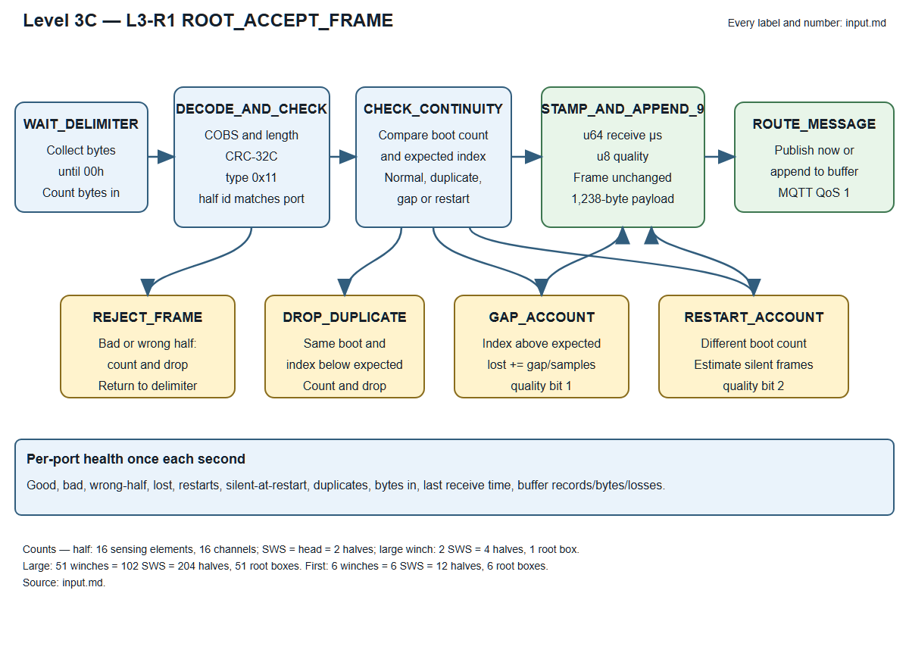 [svg](l3c_root_accept.svg)
Bytes to the next 00h, COBS-decode, CRC and type and half id; then compare boot count and first index with the last frame.
A gap is counted as lost frames (quality bit 1), a new boot as a restart (quality bit 2), a duplicate is dropped.
Health once a second per port, with every counter.

```text
type byte = u8; Frame = byte[1229]; StampedMessage = byte[1238]
type u32 = unsigned 4-byte integer; u64 = unsigned 8-byte integer
state last_boot:u8, last_first:u32, last_samples:u8, have_last:bool
state quality:u8; counters = good, bad, wrong_half, lost, restarts, duplicates

WAIT_DELIMITER:
    encoded = read bytes through the next 0x00 delimiter

DECODE_AND_CHECK:
    frame = COBS_DECODE(encoded without delimiter)
    if length(frame) != 1229 or CRC32C_INVALID(frame): bad += 1; drop
    if frame[0] != 0x11: bad += 1; drop
    if frame[1] != configured_half_id_for_port: wrong_half += 1; drop

CHECK_CONTINUITY:
    quality = 0
    boot = frame[10]; first = get_u32_le(frame[2..5]); samples = frame[6]
    if have_last and boot != last_boot:
        restarts += 1; estimate and count silent frames; quality |= 2
    else if have_last and first < last_first + last_samples:
        duplicates += 1; drop
    else if have_last and first > last_first + last_samples:
        gap = first - (last_first + last_samples)
        lost += gap / samples; quality |= 1

STAMP_AND_APPEND_9:
    message[0..1228] = frame unchanged
    put_u64_le(message[1229..1236], receive_microseconds_since_box_epoch)
    message[1237] = quality; good += 1
    last_boot = boot; last_first = first; last_samples = samples; have_last = true

ROUTE_MESSAGE:
    publish immediately only if network is up and disk buffer is empty
    otherwise invoke BUFFER_APPEND(message)
```

Against the code (`root_box.py`): a frame of the wrong type is counted as **wrong half**, not as bad; the length
follows the frame's own sample count (1 229 bytes only at 25 samples); a restart's silent frames are estimated as
round(time since the last frame / 100 ms) − 1.

### L3-R2 — the root box: a network stop

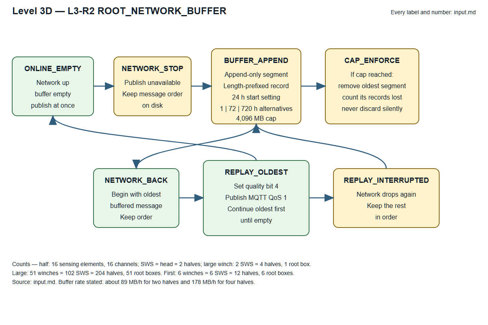 [svg](l3d_root_network_buffer.svg)
While the network is down, every message goes to append-only segments on disk, oldest segment dropped and counted at the cap.
When it is back, the buffer is sent oldest first with quality bit 4; if it drops again, the rest is kept.
**Not as the code:** the code replays in batches of 2 000 and puts an unsent rest at the end of the buffer, so with more than 2 000 records held the order is not kept.
**Not drawn:** the code's cap is the smaller of 4 096 MB and 24 h at the computed rate.

```text
type byte = u8; StampedMessage = byte[1238]
type BufferRecord = length-prefixed StampedMessage
# The buffer length-prefix size is not specified in input.md.
state network_up:bool, buffered_records:integer, buffered_bytes:integer
constant cap_bytes = 4096 MB; configured_hours = 24 | 1 | 72 | 720

ONLINE_EMPTY(message):
    if network_up and buffered_records == 0:
        publish message with MQTT QoS 1; return
    BUFFER_APPEND(message)

NETWORK_STOP:
    network_up = false

BUFFER_APPEND(message):
    append message in order to the current append-only segment
    increment buffered_records and buffered_bytes
    CAP_ENFORCE()

CAP_ENFORCE:
    while buffered_bytes reaches the cap:
        remove the oldest complete segment
        count every record in that segment as a buffer loss

NETWORK_BACK:
    network_up = true
    while network_up and buffered_records > 0:
        REPLAY_OLDEST()

REPLAY_OLDEST:
    message = oldest buffered message
    message.quality |= 4
    publish message with MQTT QoS 1
    if publish succeeds: remove that record and continue oldest first
    else: REPLAY_INTERRUPTED()

REPLAY_INTERRUPTED:
    network_up = false
    keep this and all remaining records in their existing order
```

Against the code: while anything is in the buffer, new messages go to the buffer too (order kept); the record
length is a 2-byte topic length + topic + 4-byte payload length + payload (`Spool`); the cap is
min(4 096 MB, bytes per hour × 24 h). For four halves, with a topic of about 16 bytes: (2 + 16 + 4 + 1 238) B × 10
per s × 3 600 s × 4 = 181.4 MB/h; × 24 h = 4 355 MB > 4 096 MB, so the 4 096 MB cap holds 4 096 / 181.4 = 22.6 h
(on the record's 178.3 MB/h: 4 278 MB for 24 h, 23.0 h). On a failed publish during a replay, `tick` puts the unsent
rest of its batch (at most 2 000 records) back at the end of the buffer, behind records not yet read: with more than
2 000 records held, the order is not kept.

### L3-L1 — the logger: one message, a lost frame, a restart

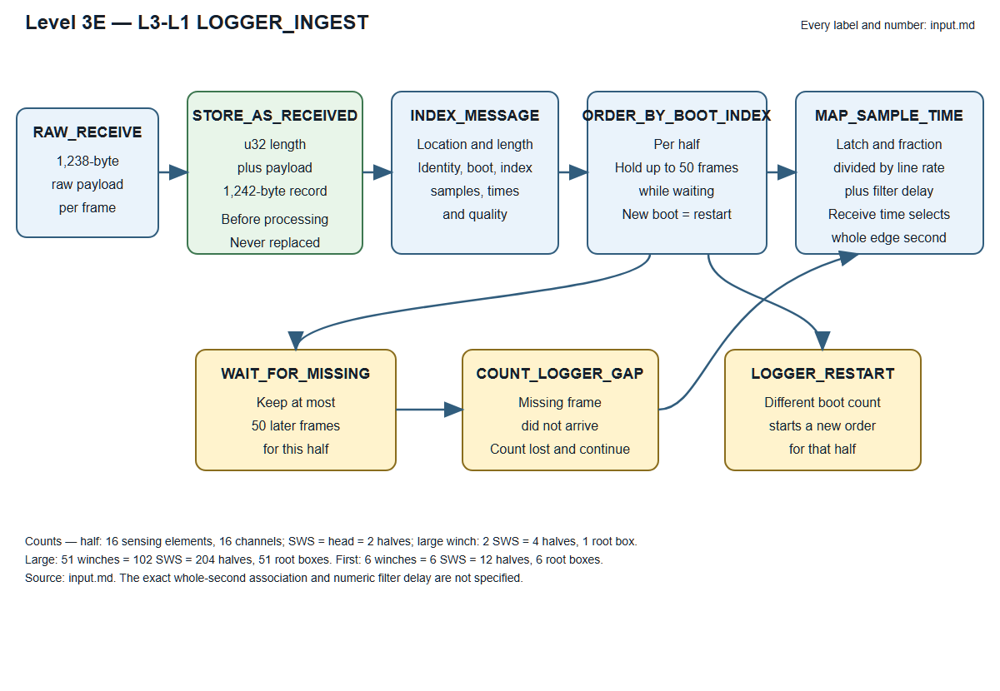 [svg](l3e_logger_ingest.svg)
Every message is stored as received (u32 length + 1 238 bytes) and indexed; frames are put in order per half.
Up to 50 later frames are held while a missing one is awaited, then the gap is counted; a new boot starts a new order.
Each sample's time comes from the latch and fraction; the receive time only picks the whole second.

```text
type byte = u8; RawMessage = byte[1238]
type StoredRecord = u32_length_prefix + RawMessage
type u8 = unsigned 1-byte; u16 = unsigned 2-byte
type u32 = unsigned 4-byte; u64 = unsigned 8-byte
state reorder_queue:ordered frames per half, maximum wait = 50 frames

RAW_RECEIVE(message:RawMessage):
    STORE_AS_RECEIVED(message)
    fields = INDEX_MESSAGE(message)
    ORDER_BY_BOOT_INDEX(fields, message)

STORE_AS_RECEIVED:
    offset = append u32(1238) followed by all 1238 message bytes

INDEX_MESSAGE:
    read half_id:u8, boot:u8, first_index:u32 and samples:u8
    read latch:u32, fraction:u16, receive_time:u64 and quality:u8
    create index row with offset, length, identity fields and these values

ORDER_BY_BOOT_INDEX:
    order per half by (boot, first_index)
    if boot differs from current boot: LOGGER_RESTART
    if the next expected frame is absent: WAIT_FOR_MISSING
    otherwise release consecutive frames to MAP_SAMPLE_TIME

WAIT_FOR_MISSING:
    hold up to 50 later frames for this half
    if the missing frame still has not arrived: COUNT_LOGGER_GAP

COUNT_LOGGER_GAP:
    count the missing range as lost and continue with the next held frame

MAP_SAMPLE_TIME:
    choose the edge's whole second using receive_time
    relative = (sample_index - latch - fraction/65536) / line_rate
    sample_time = chosen_edge_second + relative + filter_delay
    store the first sample's time in the message index
```

Against the code (`logger.py`): the index has no latch or fraction columns (they are read from the stored frame);
messages that fail to parse or the CRC, and duplicates, are not stored; a new boot is taken only once 50 frames are
held (or at the end). Otherwise as the code. The filter delay added is the centre of the converter results each
line sample averages (`sample_centre_offset_s`).

### L3-L2 — the logger: movement, runs, position, results

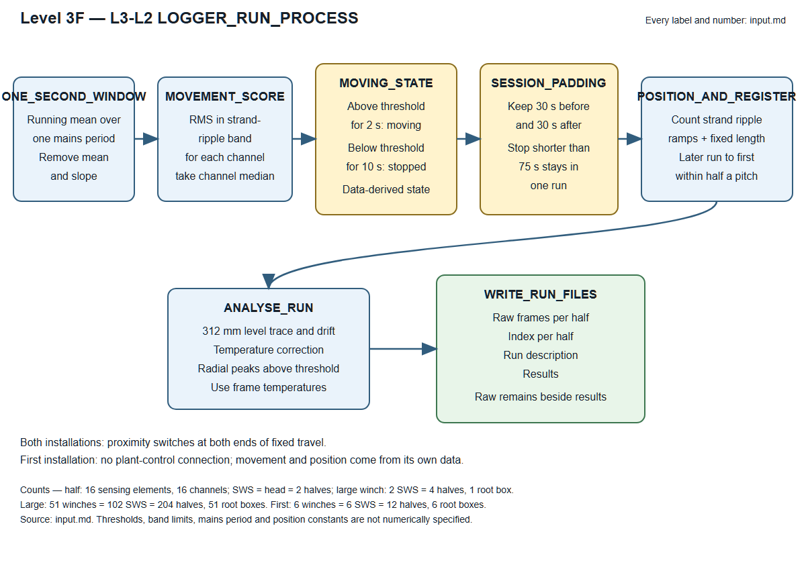 [svg](l3f_logger_runs.svg)
One-second windows give a movement score; above the threshold for 2 s is moving, below for 10 s is stopped.
Runs keep 30 s before and after; a stop under 75 s stays in the run; then position, registration, level, drift, peaks.
**Not drawn:** half 0 only per head; run files written when the session closes.

```text
type Number<?> = numeric representation not specified in input.md
type Window = 1 second of ordered, timed values for one head
state movement_score:Number<?>, moving:bool, above_seconds:integer
state below_seconds:integer, session and run collections

ONE_SECOND_WINDOW(window:Window):
    subtract a running mean over one mains period
    remove the window mean and slope
    MOVEMENT_SCORE(window)

MOVEMENT_SCORE:
    for every channel: compute RMS in the strand-ripple band
    movement_score = median of the channel RMS values
    MOVING_STATE(movement_score)

MOVING_STATE:
    if score is above threshold: above_seconds += 1; below_seconds = 0
    if score is below threshold: below_seconds += 1; above_seconds = 0
    if above_seconds >= 2: moving = true
    if below_seconds >= 10: moving = false
    retain 30 seconds before and after detected movement

SESSION_PADDING:
    if a stopped interval is shorter than 75 seconds: keep one run
    otherwise close the run and begin a later run

POSITION_AND_REGISTER:
    derive position from strand-ripple counts, ramps and known fixed length
    register every later run to the first within half a strand pitch

ANALYSE_RUN:
    calculate a level trace over a 312 mm window and calculate drift
    apply temperature correction from frame temperatures
    list radial peaks above the configured threshold

WRITE_RUN_FILES:
    write raw frames and an index for each half
    write the run description and results beside the retained raw frames
```

Against the code: `ONE_SECOND_WINDOW` **replaces** each value by its running mean over one mains period (a smoothing
that nulls 50 Hz), it does not subtract it; then mean and slope are removed and the rms per channel is taken; the
score is the median over channels. Threshold 10 µT (the 0.2–20 Hz band setting is used by the run analysis, not by this window), registration search ±20 mm (half the
40 mm pitch): settings.

## Check table

| Item (outside) | Code on main / record / own arithmetic | Agrees? |
|---|---|---|
| Frame 25 + 25 × 16 × 3 + 4 = 1 229 bytes | `half_core.h` HALF_FRAME_LEN; own: 1 229 | yes |
| Serial ≈ 1 235 bytes, 123.5 kbit/s per half | own 1 229 + 4 + 1 + 1 = 1 235 (COBS ≤ 5 + 00h); beta README reports 123.43 kbit/s | yes (upper end) |
| MQTT payload 1 238 B, 12 380 B/s per half | 1 229 + 9 = 1 238; × 10 | yes |
| Stored 1 242 B per record, 12 420 B/s, 44.7 MB/h | (1 238 + 4) × 10 × 3 600 = 44.71 MB/h; beta measured 44.71; line_calc 44.57 | yes (the brief's 44.6 is line_calc's) |
| 4 000 / 8 000 / 16 000 / 48 000 / 816 000 values/s | 16 × 250 × 1 / 2 / 4 / 12 / 204 | yes |
| Raw MQTT, first 148 560 B/s, large 2 525 520 B/s | 12 380 × 12; × 204 | yes |
| 51 winches = 102 SWS = 204 halves, 51 root boxes; first 6 SWS = 12 halves, 6 boxes | given counts; beta README (102 heads, 51 boxes) | yes |
| Filter: three CIC integrators (u64, wrapping), combs, (sum + n³/2)/n³; correction (−y0 + 10y1 − y2 + 4) >> 3 | `half_core.h`, beta README "The half in C later" | yes |
| Block: (sum + n/2)/n | same | yes |
| Clamp to −2²³ … 2²³ − 1 before packing, both filters, no health bit | beta README "Full scale"; `HALF_FULL_SCALE` | yes |
| Edge latched at the next completed line sample (3A) | `half_push`: latched when a frame completes | **no: corrected copy** |
| Health bit 0 first after boot, bit 1 send overflow until restart | `HALF_HEALTH_*`; `half_restart` | yes |
| Drop when the line is busy (3B) | drop when the 8 192-byte send buffer is full (setting) | partly (caption) |
| Wrong type counted as bad (R1 pseudocode) | `root_box.py`: wrong type or half id → wrong_half | **no: noted under the block** |
| Gap = (first − expected) / samples, quality 1; restart quality 2; duplicate dropped | `root_box.py` on_bytes | yes |
| Buffer: append-only segments, oldest removed and counted at the cap; replay oldest first with bit 4 | `Spool`, `tick` | yes |
| Replay interrupted: the rest kept in order (3D) | `tick`: unsent rest of a 2 000-record batch appended behind the rest | **no for more than 2 000 held: a code issue** |
| Buffer 24 h for a four-half box | cap min(4 096 MB, 24 h): 22.6 h at 181.4 MB/h (spool records), 23.0 h at the record's 178.3 | outside right; **an inconsistency in the settings** |
| Logger holds 50 frames for a gap | `reorder_frames = 50` | yes |
| Sample time = second from receive time + (index − latch − fraction)/line rate + filter delay | `logger.frame_times` | yes |
| Moving: subtract mains-period mean (L2 pseudocode) | `Stream._window`: smooth with it | **no: noted under the block** |
| 2 s on, 10 s off, 30 s kept, stop < 75 s in one run | settings `[logger]` | yes |
| Alternatives 80 / 100 / 125 per second "frame size not specified" | samples per frame = line rate × 0.1 s: 8 / 10 / 12.5; the Python half rounds 12.5 to 12 (96 ms frames), `settings.samples_per_frame` (used for the C half) refuses it | outside right to ask; **125 does not fit a 100 ms frame** |
| One temperature part, two temperatures | record frame: carrier and yoke temperature; the beta writes one value into both fields | the brief follows the beta |
| Alignment in the root box | record (link note §6, spec §10): root box; code: logger | differs between record and code |
| Shared RS-485, one message per box per second, real edge output, clock discipline | not built (beta README) | yes, marked "not built" |

## Not done

The existing pages (software, hardware) are not changed (adds only); the explicit counts are here and in the level-0
table, for the pages to take over when they are next built. The shared RS-485 line has no level 3 or 4 (not built).
