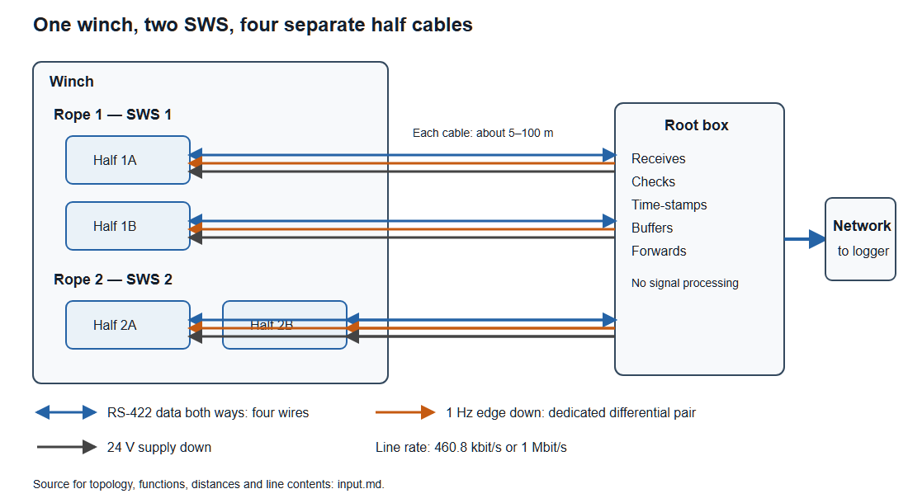
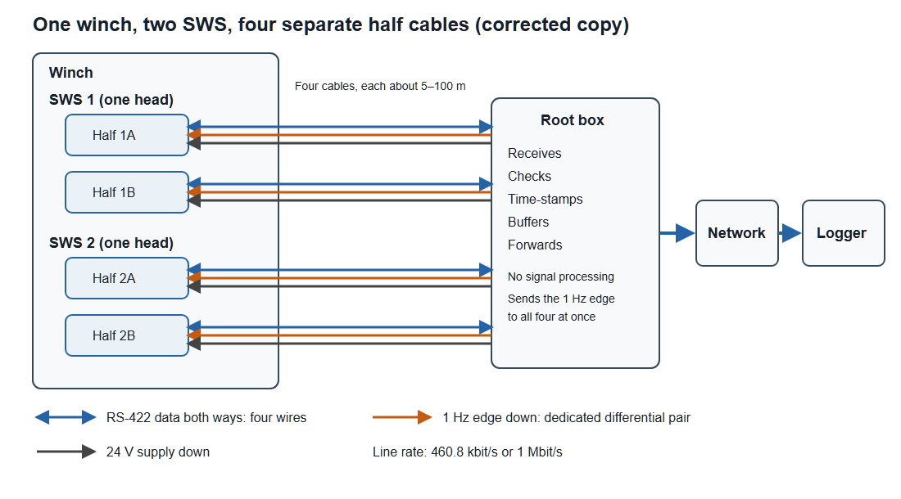
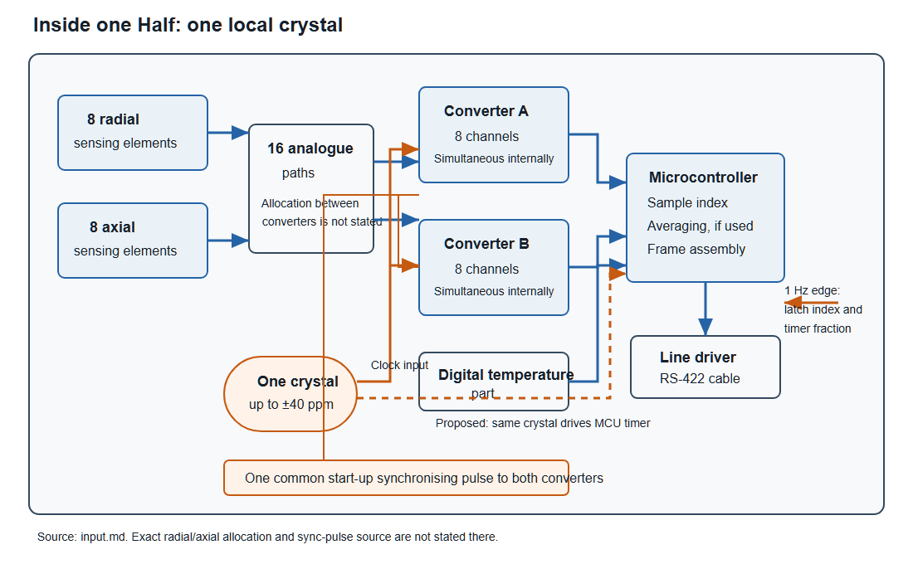
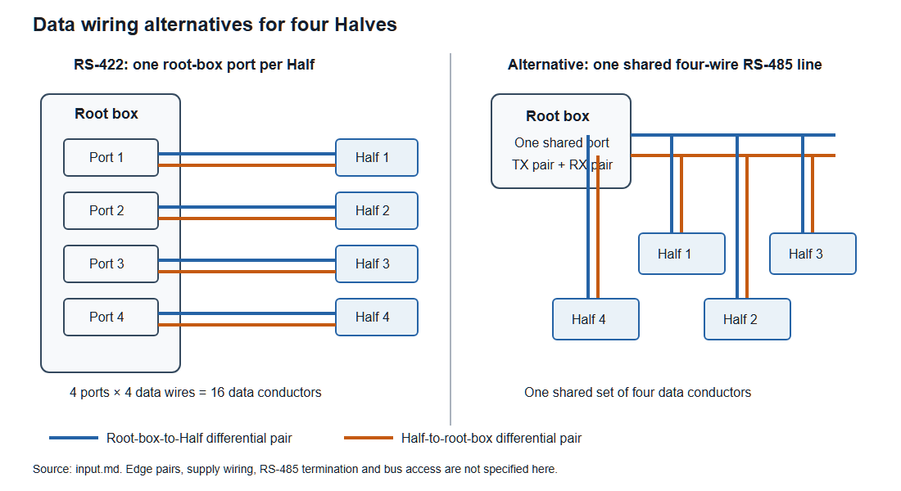
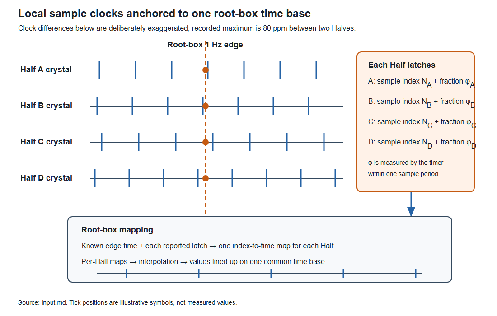
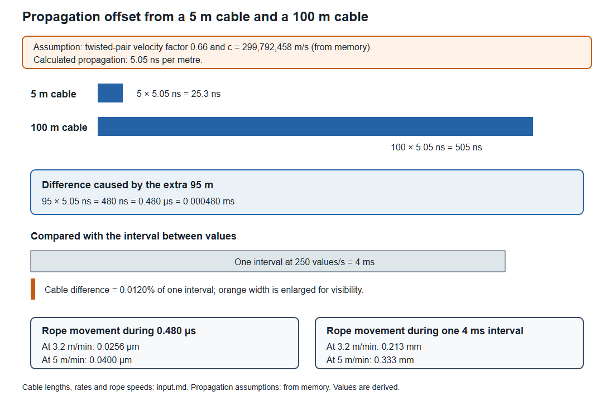
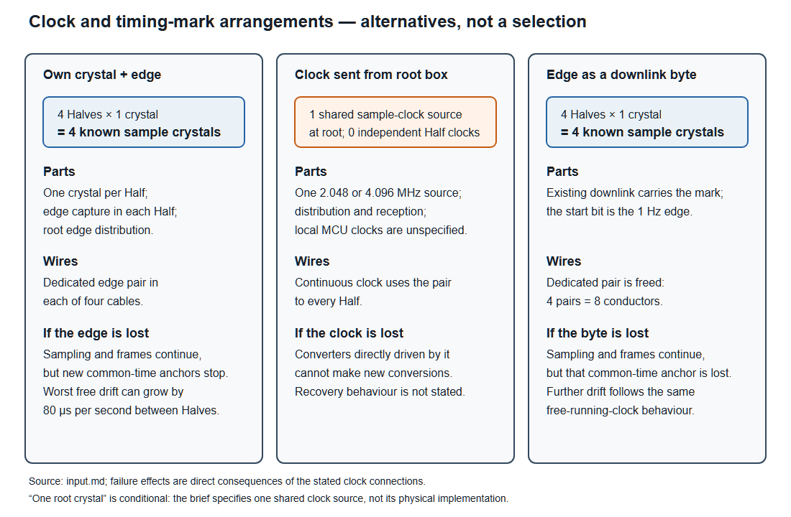

# Principle drawings: the line from a half to the root box, and its timing

Drawn by an outside model (GPT Sol, blind: it saw a short brief with the record's facts, nothing from this
repository), checked here against the record and by own arithmetic. Calculated, not measured. Nothing here is
selected; the drawings show the design on record and its alternatives side by side. Words: SWS = the whole product
on one rope; head = the part on the rope, two halves; half = one of them, with its own board; sensing element
(radial or axial), 16 per half; channel = one converter input; root box = the box at the other end of the half
cables. Own arithmetic: [line_drawings_check.py](line_drawings_check.py) → [line_drawings_check.json](line_drawings_check.json).
The outside answer, unchanged: [sol_answer.md](sol_answer.md) ("input.md" in the drawings means the brief).

## How many crystals, and does cable length give an offset?

1. On record each half has one crystal, which clocks both converters (and, as proposed, the microcontroller's timer):
   one SWS has two, one winch with two SWS has four, and the root box has its own clock that times the 1 Hz edge.
2. With the alternative of a clock sent from the root box, the converters in all halves run on one clock in the root
   box; whether each microcontroller then keeps a crystal of its own is not on record.
3. Yes, cable length gives an offset: a signal needs about 5 ns per metre in twisted pair, so on a 100 m cable an edge
   or a start command arrives about half a microsecond later than on a 5 m cable ((100 − 5) m × 5.05 ns/m = 480 ns).
4. That is 0.012 % of the 4 ms between two values, about 0.03–0.04 µm of rope at 3.2–5 m/min, and it is fixed, so it
   does not grow and could be subtracted.
5. What does grow is the difference between crystals: up to 80 ppm between two halves, 80 µs every second, 1 ms after
   12.5 s; that is why the root box sends a 1 Hz edge that every half latches, leaving 80 µs on record, 8 % of the
   1.0 ms allowed (the record's limit, derived for 15 m/min; 5.0 ms at 3 m/min).
6. So a start command sent to four halves would line them up only to within half a microsecond of cable delay at
   the start (plus the firmware's response time, not counted here), and then they drift apart; the design on record does not start them together but records where each edge fell in each
   half's own sample count.

## The drawings

**A — the whole line as blocks.**  [svg](a_line_blocks.svg)
Each half has its own cable to the root box: data both ways, the 1 Hz edge down, 24 V down.
The root box receives, checks, time-stamps, buffers and forwards; it does no signal processing (the transmitter-line note's rule 2 and the line beta; the specification and the link note still give the root box detection and alignment).
**Not as the record:** Half 2B is drawn on Half 2A's cable, which reads as a chain; corrected copy below.

**A, corrected copy.**  [svg](a_line_blocks_corrected.svg)
The same, with the four halves on four separate cables and network and logger as two blocks.
One winch with two SWS: four halves, four cables, one root box.
Changed here; the outside drawing is kept unchanged above.

**B — inside one half.**  [svg](b_inside_half.svg)
Sixteen sensing elements feed two 8-channel converters, both clocked by the half's one crystal.
The microcontroller counts samples, latches the 1 Hz edge and builds the frame; the crystal is proposed to run its timer too.
**Not drawn as the record:** the record gives the start-up pulse from the microcontroller, an RC filter before each converter input, and two temperatures (carrier and yoke) where one part is drawn.

**C — the two wirings side by side.**  [svg](c_wirings.svg)
Left: one RS-422 port and cable per half (the record). Right: four halves on one shared four-wire RS-485 line (alternative).
**Not as the record:** the record counts the shared line as two-wire, polled (four halves need 1 Mbit/s at 250 per second, 50 % load); "four-wire" is the request's wording, and four-wire RS-485 parts on record are one half per line. The edge pairs are left out.

**D — timing: four crystals and the 1 Hz edge.**  [svg](d_timing.svg)
Four halves sample on four crystals that differ slightly (exaggerated in the drawing); the edge reaches all at once.
Each half latches its sample index and the fraction of a period; the root box turns that into one time base (the record; in the line beta the logger does it).
**Differs from the record:** the outside text says interpolation removes the steady drift; the record keeps 80 µs as the residual.

**E — cable length.**  [svg](e_cable_length.svg)
About 5.05 ns per metre: 25 ns on a 5 m cable, 505 ns on 100 m, 480 ns between them.
That is 0.012 % of the 4 ms between two values and 0.026 / 0.040 µm of rope at 3.2 / 5 m/min.
Agrees with own arithmetic (velocity factor 0.66, the record's figure).

**F — the count of crystals in each arrangement.**  [svg](f_crystals.svg)
Own crystal per half: four for one winch; clock from the root box: one source; edge as a byte: four.
What is lost when the edge or the clock is lost, and which wires each needs.
**Not drawn:** the root box's own clock in every arrangement; the money (on record an oscillator is assumed at 0.3–2.0 USD per half).

### The crystal count, per arrangement (own, from the record)

| Arrangement | Per half | One SWS (2 halves) | One winch, two SWS (4 halves) | Root box | Wires per half cable | When the timing signal is lost |
|---|---|---|---|---|---|---|
| Each half on its own crystal + 1 Hz edge on its own pair (record) | 1 (converters; MCU timer proposed on the same) | 2 | 4 | its own clock times the edges | data 4 + edge 2 + supply | halves keep sampling; alignment ages by up to 80 µs per second |
| Clock sent from the root box (alternative) | 0 for the converters; MCU clock not on record | 0 | 0 | 1 clock source for all | data 4 + clock 2 + supply | converters stop: the half is blind (record: they need CLKIN) |
| Edge as a byte on the downlink (alternative) | 1 | 2 | 4 | its own clock times the bytes | data 4 + supply (edge pair freed) | as the record |

Cost on record: a clock oscillator per half, 0.3–2.0 USD (assumed, price note); with a clock from the root box a
clock distribution to all ports and a fixed cable delay of about 0.5 µs per 100 m enters the sampling instants.

## Check table

| Claim (outside) | Record / own arithmetic | Agrees? |
|---|---|---|
| One crystal per half, both converters on it, MCU timer proposed on it | link note §3 notes; sync findings §2 | yes |
| ±40 ppm per crystal, 80 ppm between two halves | register rows [R26]: 20 + 20 ppm; 2 × 40 | yes |
| 80 µs drift per second; 1 ms after 12.5 s | sync budget: 80e-6 × 1 s; 1 ms / 80 µs = 12.5 s | yes |
| 80 µs is 8 % of the 1.0 ms target | 80 / 1000 = 8 % | yes |
| Interpolation between edges removes the steady drift | record: 80 µs residual (sync findings §2; hardware page hw-cable); a smaller figure is not on record | differs (not on record; plausible, not checked) |
| 5.054 ns/m at velocity factor 0.66 | 1 / (0.66 × 299 792 458) = 5.054 ns/m; record "~5 ns/m, velocity factor ~0.66" (assumed there too) | yes; range 4.28–5.56 ns/m for velocity factor 0.78–0.60 (assumed) |
| 5 m → 25.3 ns, 100 m → 505 ns, difference 480 ns | (100 − 5) × 5.054 = 480.1 ns; 406–528 ns over the velocity-factor range | yes |
| 0.0120 % of a 4 ms interval | 480 ns / 4 ms = 1.20e-4 | yes |
| Rope in 480 ns: 0.0256 µm at 3.2, 0.0400 µm at 5 m/min | 0.05333 m/s × 480 ns = 25.6 nm; 0.08333 × 480 ns = 40.0 nm | yes |
| Rope between values: 0.213 / 0.333 mm | (3.2 / 60) / 250 = 0.213 mm; (5 / 60) / 250 = 0.333 mm | yes |
| 1 ms / 0.48 µs ≈ 2 083 | 1000 / 0.48 = 2 083 | yes |
| Clock from the root box: lost clock stops the converters | link note §5: the converters need CLKIN to run | yes |
| Half 2A's cable through Half 2B (drawing A) | one cable per half, point to point (specification; link note) | no: corrected copy |
| Radial/axial allocation between converters "not stated" | the proposed frame orders channels 0–7 radial, 8–15 axial (transmitter_line §5); the link note §1 puts channels 0–7 on the first converter: radial on the first by inference | partly |
| Sync pulse source "not stated" | link note §3: the microcontroller pulses SYNC/RESET on both converters | omission |
| Shared RS-485: one set of four data conductors | data_path.md: the shared line is counted two-wire, polled; four halves need 1 Mbit/s, 50 % load | no: four-wire is the request's wording, not the record's |
| Timer fraction measured "within one sample period" | link note: sync_frac in 1/65536 of a sample period; timer 16.384 MHz = 61 ns per tick | yes |
| Edge lost: frames continue, alignment ages | link note §5: keep streaming, flag; holdover 1.5 s proposed | yes |

## Where each topic sits

| Topic | File, section | Page anchor |
|---|---|---|
| The line as blocks; the 1 Hz edge and its alternatives | `max/sws/transmitter/transmitter_line.md`, "The line as blocks", §5 "The 1 Hz edge" | — (not on a page) |
| Crystal tolerance, drift, 80 µs, cable delay | `max/sws/hw-selection/sws_sync_findings.md` §2; `sws_sync_budget.py`; `max/sws/data/sws_sync_register_rows.md` | hardware.html#hw-cable |
| Inside a half: one clock, one SYNC/RESET, the latch | `max/sws/hw-selection/sws_link_and_readout.md` §1 and §3 | software.html#sw-half |
| Frame with sample index and sync fields | same note §4; `transmitter_line.md` §5 frame | software.html#sw-link |
| Root box: time base, alignment | same note §6 | software.html#sw-root |
| Sync schemes side by side (edge, 10 Hz, clock from root box, strobe) | same note §5 | hardware.html#hw-cable |
| RS-422 per half against shared RS-485 | `max/sws/data-path/data_path.md` sentence 5, disagreement 2 | — |
| Oscillator price | `max/sws/hw-selection/sws_price_complexity.md` | hardware.html#hw-price |

## What the outside model was unsure of (its list, shortened)

Cable velocity factor; timer resolution, edge jitter and skew; whether the root box subtracts known cable delays;
start-command latency in firmware; crystal change between edges; the clock source in the root-box-clock arrangement;
other clocks in microcontrollers and the root box; the radial/axial split between converters; RS-485 termination and
bus access; behaviour on loss of edge or clock.
