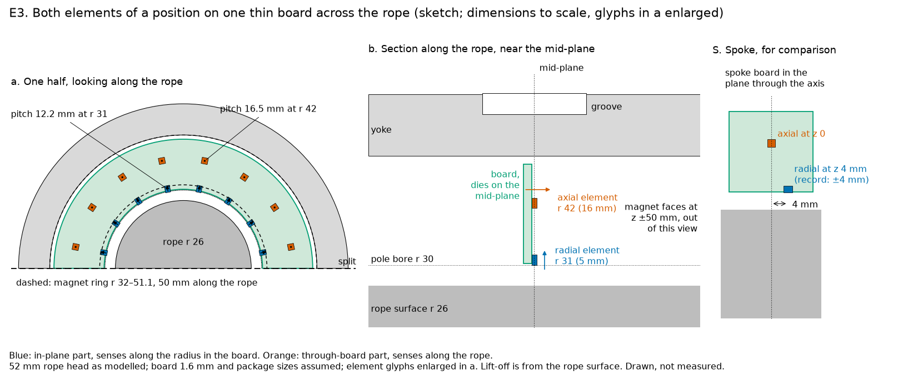
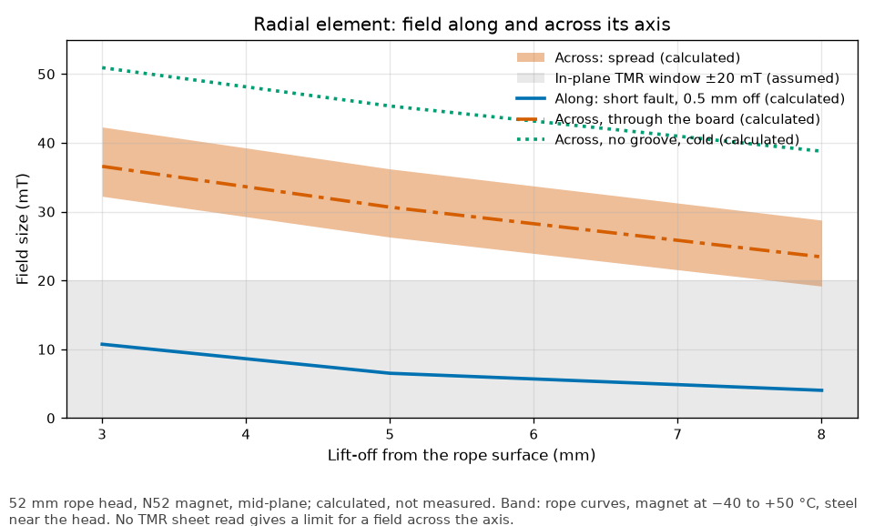
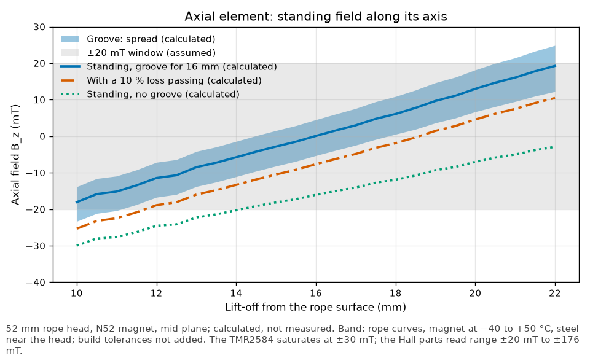

# SWS sensing board: a package for an outside review

Every figure carries a unit and a tag in square brackets, such as [S1 §4]. The tags point to our internal
source documents; ask for any one of them and we will send the source. "Calculated" means a finite-element field model, not a measurement. "Measured" means read on hardware. Nothing
in this package has been selected. Where something is "proposed", it is a proposal for you to challenge.

---

## Easy read: the whole thing on one page

1. The **SWS** (Safe Wire Sensor) is a permanent-magnet rope tester. It clamps round a steel wire rope on a
   winch and watches the rope pass at up to 15 m/min. It is built as two identical **halves** that close
   round the rope like a clamshell. Each half has its own electronics and its own cable to a **root box**.
2. The magnets drive the rope's steel close to saturation, about 2 T. Where a wire is broken, or steel has
   worn away, some field leaks out of the rope. The board reads that leakage.
3. Each half carries **8 positions**, so there are 16 round the rope at 22.5°. Each position has two
   **sensing elements**. A **radial** element sits close to the rope and finds broken wires. An **axial**
   element sits further out and follows the loss of steel over a length.
4. The board design under study is **one thin board per half**: a half-ring lying across the rope, halfway
   between the two magnet rings. On that board the radial field lies *in* the board and the axial field goes
   *through* it. So the two elements of a position need two kinds of package, or one of them mounted in
   another plane.
5. The hard part is the field the parts sit in. It is a steady field of tens of millitesla, and the parts must
   resolve changes of about a tenth of a millitesla on top of it.
6. Two 8-channel, 24-bit, simultaneous-sampling delta-sigma converters per half read the 16 elements. Two
   digital temperature sensors per half are read separately. The converter count is fixed. The exact
   converter part, the reference scheme and the sampling scheme are open for your advice.
7. The board is potted or sealed inside a non-magnetic housing. It must work from −40 to +50 °C ambient, and
   the magnets stay at or below 45 °C in service.
8. **Our main question to you**, beyond the details in section 7: which part technology for the axial element
   (TMR or Hall), and how to lay out, ground and protect a precision 16-channel analogue board that sits in a
   strong static magnetic field.

The first heads to be built are for a 40 mm rope: ten heads, six of them for the first installation (38 mm
rope) [S5 I04, I05]. The larger series is for the large installation (52 mm rope). **Most calculated figures
below are for the 52 mm head**, because that is where the model work is furthest along. The 40 mm figures we
have are given where they exist.

*Figure 1. One half seen along the rope (a), a section along the rope at the board (b), and the spoke layout
written into an early specification, for comparison only (S). This is the 52 mm head as modelled. The board
thickness (1.6 mm) and the package sizes are assumed; "record: ±4 mm" is the old spoke layout's offset. Blue: a part that senses in its own plane (radial).
Orange: a part that senses through its package (axial). [S1 Figure E3]*

---

## 1. What the SWS is and what the board must do

**The head.** Two magnet rings face each other along the rope. Each ring is made of one-piece sintered NdFeB
half-rings, radially magnetised, with no pole shoe and no segments [S5 M01]. A steel yoke closes the circuit
outside them. On the 52 mm head the magnets sit at z = ±50 to ±90 mm from the board plane (40 mm long, 100 mm
between the inner pole faces) [S5 M07]. The rope passes through a free bore of Ø60 mm [S5 B01]. The yoke wall
is 12.0 mm [S5 Y01]. The two magnet grades **N52 and N48SH are always carried side by side**; no grade is
chosen [S5 M02].

**The board's job.**
- Read 16 field signals per half (8 radial + 8 axial) continuously while the rope moves. The signal band is
  0–125 Hz (1 mm of rope per sample at 15 m/min) [S1 §1].
- Read two digital temperature sensors per half (fixed [S13]). The specification places one on the board or
  carrier and one on the yoke [S6 §7].
- Time-stamp against a 1 Hz sync edge from the root box [S6 §10].
- Stream raw values to the root box. The half does no fault detection [S6 §7].

**What is fixed by us and what is not.**

| Fixed by us | Not fixed (yours to advise on) |
|---|---|
| One thin board per half carries the elements, mounted in different planes (where the digital and power parts go is open). The spoke layout in an early specification was never confirmed. | Board thickness, outline detail and stack-up (ours to propose: no outside dimension is given) [S13] |
| Two 8-channel converters per half; 16 channels; temperature on digital parts, two per half | Converter part, gain, reference scheme, sampling and filter settings |
| Search order for the elements: TMR first; Hall only if no TMR fits, and then argued | Axial element technology (section 6); the exact parts |
| N52 and N48SH shown side by side; magnets at most 45 °C in service | 5 V rail: only if a part needs it [S13] |
| Names: SWS, head, half, sensing element, channel, root box | Line from the half to the root box: RS-485 is **proposed**, not fixed |

---

## 2. The sensing elements

### 2.1 Quantities, count and positions

- **Radial element** (one per position, 8 per half). It reads B_r, the field pointing at the rope, and finds
  local faults such as broken wires. It sits on the board plane (the mid-plane between the magnets), where
  the steady radial field is zero by symmetry [S1 §1].
- **Axial element** (one per position, 8 per half). It reads B_z, the field along the rope, and follows the
  loss of metal over a length (LMA). It sits at the radius where a groove in the yoke brings the steady axial
  field to zero (section 4.1) [S1 §1, §2].
- Both elements of a position lie on one radius line, at the same angle and on the same mid-plane. So they read
  the same spot of rope at the same moment. That is the reason for the thin board [S1 §2].

**Positions on the 52 mm head** (rope surface at r 26 mm; lift-off is measured from the rope surface) [S1 §2]:

| Item | Radius (mm) | Lift-off (mm) | Pitch between the 16 positions (mm) |
|---|---|---|---|
| Rope surface, nominal / at +4 % | 26.0 / 27.0 | 0 / 1.0 | — |
| Radial element at 3 mm (the specification's floor; not a chosen position) | 29.0 | 3 | 11.4 |
| Pole bore (free bore) | 30.0 | 4 | — |
| Radial element at 5 mm (the specification's design stand-off) | 31.0 | 5 | 12.2 |
| Radial element at 8 mm | 34.0 | 8 | 13.4 |
| Axial element, groove zero at 13 / 16 / 19 mm | 39.0 / 42.0 / 45.0 | 13 / 16 / 19 | 15.3 / 16.5 / 17.7 |
| Yoke inner face between the magnets, N52 / N48SH model | 50.1 / 51.1 | 24.1 / 25.1 | 19.7 / 20.1 |

On the 40 mm head with the radial element at 5 mm, the element radius is 25.0 mm and the pitch is 9.82 mm
[S9; S5 D04]. On the old 40 mm prototype the axial element is reported at 16.5 mm lift-off. That position is
not confirmed [S5 A02].

The 8 positions of a half are at 22.5° pitch. The split between the halves falls midway between two positions,
11.25° from each [S5 D03]. A radial element at 3 mm lies inside the pole bore (r 29 < 30). At 5 mm it is 1 mm
outside the bore [S1 §2].

### 2.2 The field at each element (all calculated, 52 mm head)

The model is a 2D axisymmetric field model with a homogenised rope, placeholder steel curves and a large model
box. The wire-break signals come from a 3D model. Nothing in this table has been measured in the head. The
grades are given as N52 / N48SH [S1 §1].

**Radial element**, with the groove set for the axial zero at 16 mm:

| Lift-off | Steady B_r along its axis (on the mid-plane) | B_r per mm off the mid-plane | Steady B_z *across* its axis (through the board) | Spread of B_z (rope curves, −40…+50 °C, magnets 1 % weaker, steel near the head) | Without a groove, cold (−40 °C) | Short strong fault, peak ΔB_r | One broken outer-strand wire, 3D | One broken inner-rope wire, 3D |
|---|---|---|---|---|---|---|---|---|
| 3 mm | 0 (≤ 0.08) | 2.5 / 2.4 mT/mm | −36.6 / −36.4 mT | −42.3…−32.2 / −42.3…−31.9 mT | −50.9 / −52.2 mT | 9.51 / 9.47 mT | 1.95–2.46 mT | 0.158–0.464 mT |
| 5 mm | 0 (≤ 0.04) | 2.9 / 2.9 mT/mm | −30.7 / −30.5 mT | −36.2…−26.3 / −36.3…−26.1 mT | −45.4 / −46.8 mT | 5.07 / 5.05 mT | 1.17–1.36 mT | 0.113–0.301 mT |
| 8 mm | 0 (≤ 0.05) | 2.7 / 2.7 mT/mm | −23.4 / −23.4 mT | −28.8…−19.2 / −28.9…−19.0 mT | −38.8 / −40.5 mT | 2.68 / 2.67 mT | about 0.6–0.7 mT (derived) | about 0.06–0.16 mT (derived) |

The 3D wire columns are at rope inductions of 1.881 / 1.989 / 2.093 T. They are one magnet case, not per grade
[S1 §1]. Strand ripple from a sound rope: B_r 4 mm off the plane 0.32–0.49 mT p-p at 3 mm; B_z at 3 mm
0.15–0.20 mT p-p [S1 §1].

**Axial element**, each at the zero of its own groove:

| Position (groove depth) | Steady B_z along its axis | Spread (min…max) | Level per 1 % of metal lost | Short fault ΔB_z | One wire (3D), outer / inner |
|---|---|---|---|---|---|
| 13 mm (4.34 mm), N52 | +0.45 mT | −5.8…+5.3 mT | −0.881 mT | −1.60 mT | — |
| 16 mm (3.58 mm), N52 | +0.09 mT | −5.3…+4.5 mT | −0.774 mT | −1.04 mT | 0.140–0.158 / 0.031–0.064 mT |
| 16 mm (3.92 mm), N48SH | +0.09 mT | −5.8…+4.7 mT | −0.802 mT | −1.07 mT | — |
| 19 mm (2.77 mm), N52 | −0.07 mT | −3.8…+3.4 mT | −0.522 mT | −0.62 mT | — |
| No groove at 16 mm, N52 / N48SH | −16.1 / −17.9 mT | −18.3…−14.9 / −20.4…−16.7 mT | −0.201 / −0.217 mT | −0.96 mT | 0.14–0.17 mT |

Across the axial element's axis, B_r is 0 on the mid-plane and 2.9–3.3 mT per mm off it [S1 §1].

### 2.3 Range and resolution each element needs

The arithmetic is shown so that you can redo it. "(d)" means derived here from the figures above.

**Axial element, range along its axis** (groove for 16 mm, N52) [S1 §1]:
- spread −5.3…+4.5 mT;
- plus build tolerance ±2.6 mT (groove depth ±0.1 mm moves the zero ±0.41 mm; element ±0.5 mm; ±0.91 mm ×
  2.9 mT/mm);
- plus a 10 % loss passing (10 × −0.774 = −7.7 mT);
- total **−15.6…+7.1 mT**.

If the zero is trimmed in place at installation, this narrows to −8.0…+0.1 mT. Without a groove it is
−21.3…−13.9 mT.

**Axial element, resolution.** The quantity it serves is % of metal, at 0.774 mT (N52) or 0.802 mT (N48SH) per
1 %. So the error budget is set by zero drift, not by noise. A change of 0.77 mT in the zero over
−40…+50 °C reads as 1 % of metal [S1 §1, §5]. LMA is a DC value, compared against a base trace taken months
earlier [S1 §1].

**Radial element, along its axis.** At 3 mm it needs about 10.7 mT (9.5 mT short-fault signal plus 1.2 mT for
0.5 mm off the mid-plane) [S1 §4]. At 5 mm it needs about 6.5 mT (d: 5.07 + 0.5 × 2.9).

**Radial element, across its axis (the critical number).** 32–42 mT of steady axial field passes through the
package with the groove, and up to 51–52 mT without one [S1 §4]. No sheet we read says what that does to an
in-plane TMR part (section 8).

**Radial element, resolution.** There are two requirements on record:
- The specification asks for **≤ 0.11 mT p-p** after the template subtraction in 0–125 Hz on the 52 mm rope.
  That figure is set on a 0.22 mT smallest signal at the worst angle, which comes from a literature transfer
  [S6 §7; S5 E13].
- The 3D model's weakest case, one broken inner-rope wire at 5 mm, is 0.113 mT zero-peak. With the acceptance
  rule "zero-peak ≥ 2 × noise p-p" this asks for **≤ 0.056 mT p-p** (d: 0.113 / 2) [S1 §4].

The two signal estimates differ several-fold and are not reconciled (section 8). The specification's noise
budget is the one on record.

**The numbers in electrical terms** (d, using the prototype parts' sheet figures at a 3.3 V supply [S1 §3]):

| | Radial (TMR2185 class, 3.4 mV/V/mT) | Axial (TMR2584 class, 5 mV/V/mT) | Axial (DRV5055-A1 class Hall, 60 mV/mT) |
|---|---|---|---|
| Sensitivity at 3.3 V | 11.2 mV/mT | 16.5 mV/mT | 60 mV/mT |
| Full signal needed | ±10.7 mT → ±120 mV | −15.6…+7.1 mT → −257…+117 mV | → −936…+426 mV around mid-supply |
| Smallest step | 0.056 mT → 0.63 mV p-p | 1 % of metal, 0.774 mT → 12.8 mV | 1 % → 46 mV |

One LSB of a 24-bit converter at ±1.2 V full scale is 143 nV (d: 2.4 V / 2^24). The converter's resolution is
not the limit. The limits are the noise and drift of the element and of the front end.

### 2.4 Candidate parts found so far (from the makers' data sheets)

"n/s" means not on the sheet. All parts below are candidates; none is selected [S1 §3].

**Radial element: parts that sense in the package plane** (they lie flat, with the axis along the radius):

| Part | Range | Sensitivity | Noise | Offset drift | Supply / current | Package | Note |
|---|---|---|---|---|---|---|---|
| TMR2185 (MultiDimension) | ±20 mT spec., ±100 mT saturation | 3.4 mV/V/mT | n/s | n/s | bridge; 77 µA at 3.3 V (d) | SOP8 / LGA4L 2.0 × 1.5 × 0.73 mm | on the old prototype |
| CT100 (Allegro) | ±20 mT linear, ±50 mT operating | 4.5 mV/V/mT | 0.16 µT/√Hz; 0.012 mT p-p in 0–125 Hz (d) | ±4.0 µV/V/K max | bridge; 0.3 mW at 3 V | SOT23-6, DFN6 | only radial part with noise on its sheet |
| TLI55910-A6E (Infineon) | ±35 mT (in-plane magnitude) | 4.8 mV/V/mT | density n/s | ±4 µV/V/K | bridge; about 0.4 mA at 3.3 V (d) | SOT23-6 | |
| TMR2084S (MultiDimension) | ±40 mT | 6 mV/V/mT | n/s | 0.008 mV/V/K | bridge; 100 kΩ | SOT23-5 | |

**Axial element: parts that sense through the package** (they lie flat, with the axis along the rope):

| Part | Range | Sensitivity | Noise 0–125 Hz | Zero drift over temperature | Supply / current | Package |
|---|---|---|---|---|---|---|
| TMR2584 (Z-axis TMR) | ±20 mT spec.; saturation ±30 mT (electrical table) or ±20 mT (selection guide) | 5 mV/V/mT | n/s | "0.5 mV max" over −40…125 °C; unit unclear (total or per K) | bridge; 1.1 mA at 3.3 V (d) | SOT23-5 |
| TMR2583 (Z-axis TMR) | ±20 mT fit, ±100 mT saturation | −1.5 mV/V/mT | n/s | unit truncated on the sheet | bridge; 3.3 mA at 3.3 V (d) | SOT23-5 / TO94 |
| DRV5055 A1 / Z1 (TI Hall) | ±21 mT (5 V figure) | 60 mV/mT at 3.3 V | 0.016 mT p-p (d) | ±1 % × VCC, typical only (±0.55 mT, d) | ratiometric single-ended; 2 mA typ | SOT-23 |
| TMAG5253 BA1 (TI Hall) | ±20 mT | 60 mV/mT | 0.016 mT p-p (d) | ±50 mV over −40…125 °C (±0.83 mT, d) | ratiometric; 2.6 mA, enable pin | X2SON-4, 0.4 mm high |
| A1304 (Allegro Hall) | ±37.5 mT | 40 mV/mT | 0.017 mT p-p (d) | ±40 mV, 25→85 °C (±1 mT, d) | ratiometric; 7.7 mA | SOT23-W; rated to 85 °C only |
| MLX91377 (Melexis Hall) | ±10…80 mT programmed | programmed | density n/s | about 0.08 mT (d) | analog, **5 V**, 11 mA | TSSOP-16 |

Set aside on the sheets [S1 §3]:
- digital-output Hall parts (PWM, SENT, SPI, I²C), because they bypass the converters;
- three-axis parts, because one package sits at one radius, while radial and axial want 5 and 16 mm. The Hall
  ones also have 0.11–0.16 mT p-p in-plane noise;
- omnipolar or narrow-range parts.

---

## 3. Converters and signal chain, as proposed

| Item | As on record | Status |
|---|---|---|
| Count | Two 8-channel converters per half: 8 radial + 8 axial = 16 channels, none spare | fixed [S5 K01] |
| Part | ADS131M08 (TI): 24-bit delta-sigma, 8 simultaneous channels, PGA 1–128; ADS131E08 the other candidate in the simultaneous family | proposal [S5 K02; S8] |
| Sampling | Our current leaning: simultaneous sampling, no multiplexer. One 8.192 MHz clock shared as CLKIN by both converters of a half, and one SYNC/RESET pulse at start | leaning, not a choice; you advise [S6 §10; S5 K08] |
| Multiplexed alternative | Considered in-house: ADS114S08 (16-bit), with ADS124S08 (24-bit) as a drop-in. 12 inputs per chip, one at a time. Its sheet gives at most 362–407 samples/s per bridge on three chips at 4000 SPS (d), and adjacent elements are not read at the same instant | on record as an alternative [S8] |
| Rate | Converter runs faster and is averaged down. On record: 4000/s decimated (simulation work) or 500/s at OSR 8192 (read-out note). Line rate about 250 values/s per channel (proposal; the specification asks ≥ 250, 500 preferred) | several values [S5 K04, V01] |
| Reference | Our position: ratiometric, with the element supply as reference where the part allows. The ADS131M08 has an external REFIN of 1.1–1.3 V (data sheet), so a 3.3 V bridge supply needs a divider. The specification text still says "internal 1.2 V only"; the data sheet says otherwise. | ratiometric fixed with the converter count [S5 K01]; how it is fed is open; two statements on record [S7 §2; S5 K03] |
| Input | ADS131M08 input impedance 330 kΩ differential at gain 1–4, ≥ 1 MΩ at gain 8–128. Bridges in the kΩ range (TMR2584 about 3 kΩ) load it lightly; a Hall output is single-ended around half supply. | data sheet [S7 §2] |
| Temperature | Two digital parts per half on I²C/SPI (TMP117 class most named; priced only). 1-wire was judged workable but weak (750 ms conversion, accuracy at −40 °C). | fixed: two per half, digital; part open [S5 T01, T02; S14] |
| Gain on record | A proposal for the simulator only: radial gain 1, axial gain 2, on assumed sensitivities | not a design [S5 K05] |
| Power | Specification: 0.2–0.4 W per half in total. A later page: under about 0.5 W. ADS131M08 21.5 mW typ in high-resolution mode (data sheet), against 6.0 mW in the register (the low-power headline). | several values [S5 S03, K07] |
| Supply | 24 V from the root box over the same cable; local 3.3 V regulation; LDOs; no ferrite or iron-cored inductors near the poles | on record [S5 S01, D05] |
| Microcontroller | One per half, Cortex-M class with SPI, DMA, UART, CRC. No part named. The half's code needs about 3.4 kB RAM at 250/s (calculated on a PC). | open [S5 U01, U02] |
| Other on record | 3-axis accelerometer and a reed/Hall "halves closed" switch "to consider"; a small test loop beside each element for in-place checks (proposal) | proposals [S5 Q01, D06] |

**Element currents, 8 per half** [S1 §4]:
- radial TMR parts: 0.3–3.2 mA;
- axial Z-axis TMR: 8.8–26 mA;
- axial 3.3 V Hall: 16–62 mA;
- axial 5 V Hall or digital parts: 48–88 mA (0.24–0.44 W at 5 V; the top of that alone exceeds the specification's 0.2–0.4 W per half).

---

## 4. The space and the environment

### 4.1 The groove and the zero (corrected figures)

A groove 20 mm wide is cut all round the outside of the yoke at the board plane. It moves the zero of the
steady axial field in towards the rope, so the axial element can sit on a near-zero background. It also raises
the loss-of-metal reading. Earlier groove figures came from a model box that was too small and were about
1.1 mm too deep; **all figures here are from the corrected large-box model** [S3 Table 1].

| Zero at lift-off | Groove depth, modelled magnet | N52, 18.1 mm magnet | N48SH, 19.1 mm magnet | Old small-box value (superseded) |
|---|---|---|---|---|
| 13 mm | 4.98 mm | 4.34 mm | — | 6.08 mm |
| 16 mm | 4.25 mm | 3.58 mm | 3.92 mm | 5.36 mm |
| 19 mm | 3.53 mm | 2.77 mm | — | 4.64 mm |

[S3 Table 1; S1 §1; S5 Y04]

The depths differ by magnet and by how the magnet was scaled in each study. They are not reconciled, and the
element-run values are the later ones. Other figures for this table:
- Each 0.1 mm of depth moves the zero about 0.41 mm [S5 Y07].
- Without a groove the zero is at 24.5 mm [S3 Table 1].
- 40 mm head (model): 4.00 / 3.23 / 2.64 mm for a zero at 10 / 13 / 16 mm [S3 Table 1].
- On the 40 mm head, a groove cut for a 40 mm rope leaves about −6 mT at the 16 mm element with a 38 mm rope
  [S10].
- The old 40 mm prototype has a 10 × 2 mm groove. Its zero, as drawn and calculated, is at 16.7 mm
  [S5 Y08; S4 Figure D].

### 4.2 Board outline and thickness

- **In the board plane (radial):** the board runs from the bore (r 30 mm) to the yoke face (r 50.1–51.1 mm in
  the model). A half-ring from about r 30 to r 49.5 mm is 19.5 mm wide radially. At the radial element there is
  12.2 mm of arc per position (r 31) for the part, its decoupling and its traces [S1 §2].
- **Along the rope (thickness):** 100 mm between the magnet faces, so board plus parts (a few mm) is not limited
  there [S1 §2]. Board thickness is ours to propose; 0.8–1.6 mm is assumed in the sketches [S5 D02].
- **The squeeze is radial at the radial element.** The rope grows +4 % (1 mm) and moves 2–3 mm. A guard or
  liner sits in front of the element, and the die sits some depth inside its package. The record has two
  stand-off stacks for 5 mm (liner 1.5 + recess 2.5 + die 1.0; or movement 3 + guard 1 + die 0.7 = 4.7) and does
  not say which the carrier follows [S1 §2; S5 L02].
- **Protection.** On the prototype the radial elements had no protection, sat too close to the rope and broke
  [S1 §2]. The guard over the magnets is non-magnetic metal (Nitronic 60 or annealed 316L, 1.5–2 mm). The
  rope-contact liner is a replaceable polymer (UHMW-PE, PA6 or PEEK, about 2 mm) [S6 §9]. A thin stainless
  sleeve costs nothing in 0–125 Hz by eddy currents (1 mm of 316L: under 25 µs, corner above 6 kHz,
  calculated). It costs only its thickness, and each millimetre costs roughly 15–27 % of signal near 3–8 mm
  [S1 §2].
- **Connectors and cable.** No connector inside the head is stated for a thin board [S5 N04]. Cable entry on the
  prototype design: a Ø12 mm radial hole at z +41.5 mm [S5 N05]. No cable crosses the split; the halves are
  independent [S6 §10].
- **Where the converters and microcontroller sit on a thin board is not on record.** The early layout put them
  on a backplane outside the pole fringing field [S6 §6]. On the thin board, the steady axial field at r 36–48
  mm (10–22 mm lift-off) runs from about −18 to +19 mT with the groove (calculated, Figure 3). Outside the yoke
  it is not calculated.

### 4.3 The field the parts live in

*Figure 2. Radial element: the field along its sensing axis (blue) and the steady field across it, through the
board (orange band), against lift-off. 52 mm head, N52, calculated. N48SH is within 0–1.4 mT of these values
(table 2.2). The grey band is the prototype part's specified range along its axis; no
sheet gives a limit across the axis. "Standing" in the figures means steady. [S1 Figure E1]*

*Figure 3. Axial element: the steady field along its axis against lift-off, with the groove for 16 mm, its
spread, a 10 % loss passing, and no groove. 52 mm head, N52, calculated. The caption's ±30 mT for the TMR2584 is
one of two figures on its sheet (±20 or ±30 mT); the 3.3 V Hall options in section 2.4 are ±20–37.5 mT. [S1 Figure E1]*

- **Field across a TMR film.** On the thin board the 30–50 mT axial field goes *through* the radial part's film.
  On a spoke the same field would lie *in* the film plane, across the axis. Neither case is on any sheet
  [S1 §2, §8].
- **Exposure while open.** The head ships open and empty [S6 §9]. When it is opened beside the magnets, or
  handled, the parts see larger fields. On the old prototype, a strong magnet once snapped onto the yoke. The
  readings moved by up to 11 mT and stayed changed: radial by 0.4–2.5 mT, axial by up to 0.64 mT. The cause
  could not be separated (element, yoke, rope or a moved head). This is **measured**, from a first analysis of
  one recording; the mT values rest on the sheet sensitivities [S12].
- **Measured on the old 40 mm prototype** (TMR2185 radial, TMR2584 axial; same first analysis, mT from the sheet
  sensitivities) [S12]:
  - steady axial field at the elements −3 to −10 mT; radial within ±3.4 mT;
  - axial noise 0.6–1.0 µT rms in 1–10 Hz; five radial channels as quiet, seven 5–13 times noisier;
  - axial drift 1–7 µT per hour at rest;
  - level shifts with the direction of travel: radial up to 2.4 mT, axial up to 0.9 mT;
  - strand ripple 0.17–2.33 mT p-p radial, 0.08–0.15 mT p-p axial;
  - axial up to 0.25 mT per mm of rope off centre.
  The rig's speed, travel, temperature and fault sizes are not on record, so none of this is yet in % of metal.
- **Nearby steel.** A steel shell, a beam within about half a metre, or a second head on the same rope shifts
  the axial element's steady field by up to about 5.5 mT. That reads as about 1–8 % of metal. A calibration at
  installation removes this only while the surroundings stay as they were [S3 Table 2]. Housing and covers
  are to be non-magnetic [S6 §9].
- **Stray field** of the head: 0.5 mT at about 0.5 m from the axis [S5 H07].

### 4.4 Temperature, sealing, potting

- **Temperature.** −40…+50 °C at most ("real life −40 … 50 max", fixed; whether this is the ambient at the head
  is open). Magnets are at most 45 °C in
  service, with the head fully covered (fixed) [S5 H10, M06]. Electronics parts are rated −40…+85 °C
  [S6 §9]. +80 °C stays as a qualification reference only [S6 §9]. Total dissipation is 0.2–0.4 W per half;
  the self-heating is called negligible [S6 §7]. The sun is not: a light-coloured unit in full sun runs up to
  +16 K above air (+5 K under a shade), at night −5 K below it, and a closed hoist house adds 5–10 K [S6 §9]. The rule on record is to keep the line driver and regulator against the housing
  wall, away from the elements [S6 §9].
- **TMR sensitivity drift** of 0.1–0.3 %/K is named as the dominant thermal error. It is handled by ratiometric
  read-out, differencing and the temperature channel [S6 §9].
- **Ingress.** IP66/IP67 (fixed). The head is never submerged but gets water cast at it in a storm [S5 P02].
- **Potting.** Open [S5 P01]. The specification advises a soft polyurethane or silicone gel over the board, with
  hard epoxy only as a shell, because hard epoxy cracks and stresses dies over −40…+85 °C cycles [S6 §9].
  One proposal on record: soft silicone gel in a closed shell, room-temperature cure capped at 35–40 °C; its volume
  changes +2.7 % to +50 °C and −6.3 % to −40 °C [S5 P03].
- **Cure-temperature limit.** About 64 °C for 85 °C-rated parts, or about 60 °C with N52 magnets nearby
  [S5 P04].
- **EMC and earthing.** Qualification to IEC 61000-6-2 / -4 [S6 §2]. Cable length from half to root box is set
  by the hoist layout (not set; up to about 100 m on record) [S6 §10]. Whether the yoke or the structure is
  earthed is not on record.
- **Mechanical.** Rope slap, vibration, ferrous wear dust drawn to the poles, and rope lubricant on the bore
  [S6 §9].

---

## 5. What leaves the board (short)

Each half sends raw values only:
- 16 channels as 24-bit samples, about 250 values per second per channel (proposal);
- the temperature readings and status, packed into 100 ms frames of 1 229 bytes (1 235 on the wire) with a CRC-32C;
- about 123.5 kbit/s on a 460.8 kbit/s line (27 %) [S5 V01, Z02, Z03].

The line to the root box is **proposed as RS-485** (the specification still has RS-422, one per half). It runs
with 24 V on the same shielded cable and a separate pair for a 1 Hz sync edge, which each half latches against
its sample counter (80 µs residual) [S5 N01, N02, Z04]. The root box does all detection [S6 §10].

---

## 6. The open point: Hall or TMR for the axial element

Both options lie flat on the thin board. The radial element stays an in-plane TMR part in both [S1 §2].
Figures are for the groove case.

| | **Option A: Z-axis TMR bridge** (TMR2584 / TMR2583) | **Option B: 3.3 V linear Hall, ratiometric** (DRV5055 A1/Z1, TMAG5253 BA1, A1304) |
|---|---|---|
| Fits the search order (TMR first) | yes | only if A fails, and then argued |
| Range against need (−15.6…+7.1 mT; no groove −21.3 mT) | ±20 mT specified, saturates at ±30 (or ±20) mT: groove only | ±20–37.5 mT, no saturation stated: groove; A1304 also without a groove |
| Zero drift −40…+50 °C, as % of metal | 0.4 % if the TMR2584's offset figure is a total; **12 % if it is per kelvin** (the sheet does not say) | 0.7–1.3 % (DRV5055 figure typical only; could reach about 1.4 %); needs a per-part temperature table |
| Noise | not on the sheets; measured on the prototype 0.6–1.0 µT rms in 1–10 Hz [S12] | 0.016–0.017 mT p-p in 0–125 Hz (d), about 0.02 % of metal |
| Drift over life | not on the sheets | stated on the sheets (e.g. 0.17 mT, TMAG5253) |
| After a strong field | risk of a shifted zero (pinned / free layer); not on the sheets | Hall die has no magnetic memory; lead frame magnetisation named as a risk |
| Current, 8 per half | 9–26 mA | 16–62 mA |
| Into the converter | bridge, differential, ratiometric: direct | single-ended around half supply: negative input to a half-supply divider of the element supply |
| Prototype experience | the old prototype carries it (TMR2584) | none |

[S1 §4, §5; S2 easy read and Hall paragraph]

**Proposed** (for you to challenge, not a decision):
- Keep a **Z-axis TMR bridge (Option A) as the first line** for the axial element. It follows the search order,
  fits the range with the groove, reads ratiometrically like the radial bridges, and is the part the
  prototype already carries.
- Lay out the axial position so that a **3.3 V ratiometric Hall part (Option B)** can be fitted instead. That
  means room for the footprint and a half-supply divider at the converter input.
- Let **two prototype measurements decide**: the axial zero over temperature (at least −20…+45 °C, extended to −40 °C by
  the fitted slope until a cold run is made), and the
  axial zero before and after exposure to a strong field.
- Move to Hall if the TMR part's zero moves by more than 0.77 mT (1 % of metal) over −40…+50 °C or after
  exposure.

*Pros of the proposal:* nothing is built on Hall before TMR has been tried; the decision rests on one measured
number.

*Cons:* a board that takes either part costs layout room in a 16.5 mm pitch. The TMR2584's drift unit is
unclear until measured. The one strong-field event on the prototype already moved an axial channel by 0.64 mT,
close to the 0.77 mT limit, with the cause not separated.

---

## 7. What we ask you

Each question stands on its own.

1. **Architecture.** Is one thin half-ring board per half, carrying elements, two converters, the
   microcontroller, regulators and line driver, sound in this field? Or would you put the digital and power
   parts on a second board further from the poles, and why?
2. **Converter.** For 16 bridge or Hall signals at 0–125 Hz, would you use two simultaneous 8-channel
   delta-sigma converters (ADS131M08 or ADS131E08 class) or a multiplexed converter (ADS124S08 class)? Which
   one would you use, and with what output rate and decimation?
3. **Reference.** The ADS131M08's external reference is 1.1–1.3 V. Is a divider from the 3.3 V element supply a
   sound ratiometric reference, or would you use a separate reference and read the supply? What does each cost
   in noise and drift?
4. **Hall into a delta-sigma.** If the axial element is a single-ended ratiometric Hall part, is the negative
   input at a half-supply divider sound? What does it cost in noise and common-mode error?
5. **Field across a TMR film.** What does 30–50 mT through the film of an in-plane TMR bridge (the thin board)
   do to its gain, zero and hysteresis? And the same field lying in the film plane across its axis (as on the old spoke layout)?
6. **Zero after a strong field.** Does a Z-axis TMR bridge keep its zero after the head is opened, handled or
   exposed to a near magnet? Is a set/reset or a check procedure needed?
7. **TMR2584 offset.** Is its "0.5 mV max" offset temperature figure over −40…125 °C a total or per kelvin? What
   long-term offset drift does a Z-axis TMR bridge show in your experience?
8. **Hall drift.** How much of a 3.3 V ratiometric Hall part's 0.5–1 mT zero drift does a per-part temperature
   table remove? Do you know a 3.3 V analog Hall part with under 0.1 mT drift over −40…+50 °C?
9. **Layout in a strong static field.** What rules would you set for parts in tens of mT: regulators,
   decoupling capacitors, crystals, ferrite, magnetic lead frames and solder finishes, current loops near the
   elements? Is an LDO-only supply in the head the right rule?
10. **Grounding and shielding.** How would you ground and shield a 16-channel low-noise front end with a 24 V
    feed and an RS-485 line on one shielded cable, in a steel structure with two independent halves that never
    share a cable?
11. **Potting and reliability.** Soft silicone gel, polyurethane, or a sealed housing with a vent: what would you
    use over small SOT/DFN magnetic parts for 10 years at −40…+50 °C, outdoors, with a cure limit near 60 °C?
12. **Element protection.** For a radial element at 3–5 mm from a rope that moves 2–3 mm, would you protect
    it with a polymer liner or a thin non-magnetic stainless sleeve? What thickness would you use?
13. **In-place self-test.** Is a small printed loop beside each element, driven to give a known field, worth its
    cost for checking gain in service?
14. **Board thickness and stack-up.** What thickness and layer count would you choose, given that a thicker
    board moves the die further from the mid-plane?
15. **What you would do differently.** Looking at the whole chain, what would you change first?
16. **What you need from us.** What is missing for you to give firm advice: drawings, measured fields, part
    samples, the prototype board?

---

## 8. What is not yet known

- **No field has been measured in a new head.** Every field figure above is calculated. The models use
  placeholder steel and rope curves, and the yoke steel grade is not on record [S5 Y02].
- **The broken-wire signal size.** A literature transfer gives 0.39 mT at 5 mm. The 3D model gives 1.17–1.36 mT
  for one outer wire and 0.113–0.301 mT for one inner wire. The noise budget is set on the smaller literature
  figure. A single-wire test on a known rope is needed [S5 E15; S1 §1].
- **What a field across the sensing axis does to any part**, at 30–52 mT. No TMR or Hall sheet read gives a
  figure [S1 §8].
- **Noise of the Z-axis TMR parts and the wide-range in-plane TMR parts**, and the long-term offset drift of any
  TMR bridge, are not on the sheets [S1 §8]. The prototype gives a first measured noise and short-term drift
  for the TMR2584 (section 4.3), not yet over temperature or over months.
- **The TMR2584's offset unit**, and whether it saturates at ±20 or ±30 mT. Its own sheet has both [S5 A07].
- **The zero after a strong field**, for either technology. The one prototype event is not separated by cause
  [S12].
- **Where the die sits in each package.** Its depth from the edge facing the rope, and its tilt, are not on
  the sheets. A 1° tilt puts 1.7 % of the across-axis field (0.5–0.9 mT) into the reading [S1 §2, §8].
- **Which stand-off stack the carrier follows**, the liner bore, and the board thickness [S5 L03, D02].
- **The magnet thickness.** It is a working window, not a size, so the yoke face radius (the board's outer
  edge) moves with it [S5 M08, M10].
- **Board outline for the 40 mm head**, which is built first. Only the pitch (9.82 mm at r 25) and the
  prototype's reported 16.5 mm axial lift-off are on record [S5 D04, A02].
- **Converter rate, line rate, line type and bit rate.** These are proposals, not settled [S5 K04, V01, N02,
  Z01].
- **Whether the 5 V rail exists.** It exists only if a part needs it [S5 S02].
- **Power per half.** The specification gives 0.2–0.4 W, a later page under about 0.5 W, and the converter
  power has two figures on record [S5 S03, K07].
- **Price and availability** of the newly read element parts [S1 §8].
